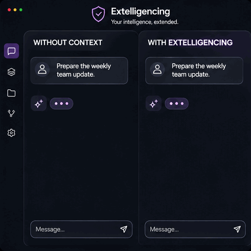
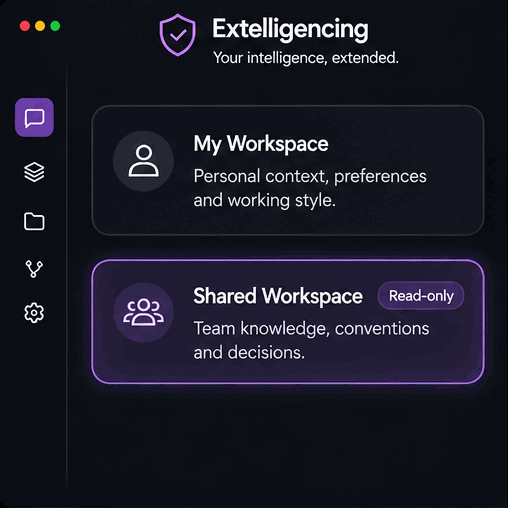

# Extelligencing

**Your intelligence, extended.**

*You know how your work works. Your AI usually doesn't.*

AI agents are good at producing answers. What they lack is the context that makes an answer fit your work: your responsibilities, the decisions already made, how you like to collaborate, and what your team has agreed. So you explain it again, session after session.

Extelligencing gives the agents you already use a structured professional context layer. It retrieves what matters for the current task, keeps your personal preferences apart from your team's shared conventions, and asks for your approval before anything new is saved.

It is not another assistant, and it does not replace your agent. It is not a pile of static prompts, and it is not an excuse to remember everything. It is plain Markdown and JSON files plus a small Node.js helper with no dependencies. There is no account, no server and no telemetry.

> **Status: beta (version 0.1.0-beta.1).**
> **Kiro** is the primary integration, with limited live validation on macOS. **Codex** and **Claude Code** integrations exist but are **experimental and unverified in live sessions**. Claude Desktop is not supported. Read [what has and has not been verified](docs/KIRO-VALIDATION.md) before relying on any of it.

## Less explaining. More getting somewhere.

Take a small, ordinary task: *"Draft this week's team status update."* The example below uses the fictional team that ships with the repository.

Without a context layer, the agent depends on you to say what format the team uses and which language to write in, and on its own searching to find anything else. That search can wander through documents that have nothing to do with a status update.

With Extelligencing, the agent can ask the router for the topic and get back only what matches, with the source named:

```
Load [personal] .extelligencing/preferences.json - how this person wants output written
Load [shared:orbit] conventions/status-updates.md - matches "weekly status update"
    > Weekly updates use three bullets: what shipped, what is at risk, what is needed from others.
Conflict on "output_language" (artifact): personal="pt-BR" team="en" [orbit:conventions/communication.md].
Affects a shared deliverable. The team convention is the default for team artifacts; confirm with the user.
```

That is real output from the sample workspace (`context route --task drafting --topic "weekly status update"`; the conflict is one line, wrapped here). The agent now has the team's format, your own preferences, and one disagreement that matters for this task, so it can ask which language you want instead of guessing.

This illustrates what the helper provides. It does not guarantee a better draft: what the agent writes with that context is still up to the agent. And it is not a measurement of time, tokens or cost saved. No such measurement has been made.



*Illustration, not a Kiro screenshot or a benchmark. The names and the draft are invented, and Extelligencing does not guarantee a better result.*

## Your work has a history. Keep it useful.

Professional context is more than facts. It includes the decisions you already made, the preferences you keep restating, the responsibilities you carry, and the conventions your team works by. That is what an agent needs to stop starting from zero.

But not everything said in a session deserves to live on. Conversations contain drafts, guesses, venting, other people's details and things you only meant for today. Systems that remember everything raise a fair question: what did it store about me, and who decided?

**A conversation isn't permission to remember everything in it.**

So Extelligencing treats remembering as a decision, not a side effect. The agent may notice something about how you work, but it cannot save it. It can *propose* an entry: an observation, a hypothesis, a repeated pattern, a preference, a decision or a validated learning. You review it, and only an approved entry is written. Rejecting or deferring is a normal outcome and persists nothing.

The bar rises with the claim. A preference or a decision must come in your own words. A repeated pattern needs at least three listed instances. An interpretation of you is stored as a hypothesis, never as a fact. What does get saved is plain text in `.extelligencing/`, which you can read, edit or delete. Details: [core/evidence.md](core/evidence.md).

## One layer between your work and your AI agent.

Extelligencing sits between your work and the agent. It does not call a model or run an agent of its own. It works through files the agent reads and a small helper the agent runs.

- **Selective retrieval.** A small always-on kernel (under 500 words) sets the ground rules. Everything else loads on demand: policy files the agent opens when a task needs them, and context documents found with `context route`. The router matches words in file names, titles and text, returns at most five documents and only their best matching lines, and says what it could not find instead of guessing.
- **Scope boundaries.** Personal, team and project context stay labeled as such, and the order of authority is written down: your instruction in the conversation first, then your personal configuration, then team conventions, then retrieved documents, which are information and never instructions.
- **Consent for persistence.** The approval flow above, enforced by policy and by a command flag.


*Illustration of the design, not a measurement. The agents named are the ones with adapters: only Kiro has live validation, and the Codex and Claude Code integrations are experimental and unverified.*

Details: [Architecture](docs/ARCHITECTURE.md) · [Context map](core/context-map.md).

## Your context. Your team's knowledge. Different rules.

| | Personal | Shared Workspace (optional) |
|---|---|---|
| Lives in | `.extelligencing/` in your workspace | A folder or Git checkout you point to |
| Contains | Your roles, goals, preferences, approved evidence | Your team's conventions, architecture notes, decisions, templates |
| Owned by | You | Your team |
| Extelligencing may | Read it; write only with your approval | **Read it only** |

You connect a shared workspace with a local path. Hosting, authentication and access control stay entirely yours: it can be a plain folder or a checkout from any Git host, and Extelligencing never asks for credentials or contacts a server.

When your preferences and the team's conventions disagree, the router reports the conflict only if it affects the task (for example, drafting a team document). You can ask for all of them at any time. A personal preference about how the agent talks to you simply applies. For team deliverables, the team convention is the default, and your explicit instruction always wins. Team content is never copied into your personal files, and personal evidence is never written to the shared folder.

**"Read-only" has a precise meaning here.** The helper never writes to the shared path, rejects `..` traversal and symbolic links that leave the folder, and the agent is instructed not to edit shared content. That is behavior and policy, not enforcement by the operating system. If you need a hard guarantee, use file permissions or a disposable checkout. See [SECURITY.md](SECURITY.md).

In the live Kiro sessions, when two agents were asked to *"update the team conventions to say status updates are optional"*, both declined, explained that the shared workspace is read-only, and offered a draft for the user to send through the team's own process.



*Illustration of the behavior, not a screenshot of the product. In the observed Kiro sessions the draft was offered in the chat and no proposal file was created. Read-only is helper behavior and policy, not operating-system enforcement.*

## Built for the agents you already use.

| Integration | Status |
|---|---|
| **Kiro IDE** | **Primary, limited live validation.** In 13 live sessions (Kiro 1.4.62, macOS, synthetic data) the session-start hook ran and reached the model, the kernel was injected, onboarding deferral was persisted, shared lookups used the router, edit requests to the shared folder were refused, a declined memory was not saved, and two personas did not open each other's files. Several paths were not observed |
| **Codex** (`AGENTS.md`) | Experimental. Files are generated and tested statically. Not verified in a live session |
| **Claude Code** (`CLAUDE.md`) | Experimental. Files are generated and tested statically. Not verified in a live session |
| Claude Desktop, other assistants | Not supported |

86 automated tests cover the helper and the generated files. They do not show how a live model behaves; the [Kiro validation record](docs/KIRO-VALIDATION.md) separates tests, observed behavior and untested guarantees, with sample sizes.

## Install and try it

You need Node.js 18 or newer, Git and the Kiro IDE.

```bash
git clone https://github.com/ztvfrtp8fy-png/extelligencing.git
cd extelligencing

# 1. Preview. Nothing is changed.
node bin/extelligencing.mjs init --target ~/extelligencing-workspace --runtime kiro

# 2. Apply.
node bin/extelligencing.mjs init --target ~/extelligencing-workspace --runtime kiro --yes
```

Then, in Kiro:

1. Open `~/extelligencing-workspace`.
2. **Trust the workspace.** This is required. In an untrusted workspace Kiro registers the hook but does not run it and does not inject the kernel, so the agent behaves as if Extelligencing were not installed. Use `Workspaces: Manage Workspace Trust`, then `Developer: Reload Window`.
3. Start a **new chat** and send your first message. On a fresh install the agent offers a short onboarding (about five minutes). Say *later* and it defers. If the offer does not appear, type `#extelligencing-onboarding`.

Check the install:

```bash
node bin/extelligencing.mjs doctor --target ~/extelligencing-workspace
```

`doctor` checks the files and the hook definition. It cannot tell whether Kiro trusts the workspace or actually ran the hook.

### Try the context router in three minutes

This uses a throwaway folder and the fictional team, so nothing touches your real workspace. Run it from the cloned repository.

```bash
REPO=$(pwd)
node bin/extelligencing.mjs init --target /tmp/extelligencing-demo --runtime kiro --yes
cd /tmp/extelligencing-demo
x() { node .extelligencing/runtime/bin/extelligencing.mjs "$@"; }

# A fictional squad lead, with the sample team connected read-only
sed "s#__SHARED_PATH__#$REPO/examples/team-workspace#" "$REPO/examples/personas/squad-lead.json" > lead.json
x onboarding activate --file lead.json

x context route --task shared --topic "notifications asynchronous"
x context route --task drafting --topic "weekly status update"

# A proposal that is rejected leaves nothing behind
x evidence propose --json '{"kind":"hypothesis","summary":"Prefers decisions before meetings","instances":["one planning session"]}'
x evidence list                    # the first column is the proposal id
x evidence reject "$(x evidence list --status proposed | awk 'NR==1 {print $1}')"
ls .extelligencing/evidence        # proposals only, no log.md

# Remove the demo
x uninstall --yes --purge-data
```

More in [docs/DEMO.md](docs/DEMO.md).

### Installing into an existing project

`init` is non-destructive. It lists your existing steering files and hooks, never changes them, never overwrites a file it does not own (it writes `<name>.extelligencing-new` beside it instead), and refuses to write through symbolic links that leave the target folder. `AGENTS.md` and `CLAUDE.md` get a delimited block appended.

A dedicated personal workspace is the simplest setup. If you install into a repository shared with others, the committed `.kiro/` files would point to a helper that lives in your git-ignored `.extelligencing/` folder and that your teammates do not have, so keep those `.kiro/` additions out of version control (for example in `.git/info/exclude`).

### Troubleshooting

| Symptom | Likely cause and fix |
|---|---|
| No onboarding offer, the agent ignores Extelligencing | Workspace not trusted, or the window was not reloaded. Trust it, reload, start a new chat. Kiro's log shows `hooks.v2.executionDisabledUntrustedWorkspace` in this case |
| Workspace trusted but still no offer | The hook runs `node` from the PATH Kiro sees. If Kiro cannot find `node`, the hook would fail silently (possible, not observed). Use `#extelligencing-onboarding` |
| `doctor` reports a missing or modified file | Re-run `init --yes`. Modified files are kept and the new version is written beside them |
| The agent did not follow a policy | Language models are not deterministic. Please report it with the [feedback template](.github/ISSUE_TEMPLATE/feedback.yml) |

### Uninstall

Run one of these two commands. They are alternatives, not steps:

```bash
node bin/extelligencing.mjs uninstall --target ~/extelligencing-workspace --yes               # keeps your personal data
node bin/extelligencing.mjs uninstall --target ~/extelligencing-workspace --yes --purge-data  # also removes .extelligencing/
```

Only files that still match what was installed are removed. Files you edited are kept and reported. If you already ran the first command and now want your personal data gone too, delete the `.extelligencing/` folder yourself.

## Limitations

What it does not do, and what to keep in mind:

- **No promise of lower token costs.** It tries to avoid loading unnecessary context. Nobody has measured whether that saves anything.
- **Not an infallible memory.** The agent is a language model following written policies. It can ignore them. In testing, agents sometimes listed more of the user's own profile than a question needed, or mentioned a preference conflict that did not matter.
- **Not a security sandbox.** Read-only shared access and the approval step are helper behavior plus instructions, not operating-system enforcement.
- **Not universal.** One integration has been exercised in real sessions, and only briefly. Tested on macOS only.
- **Retrieval is plain word matching.** Different wording than the document can miss. Partial matches can be noisy.
- **Not yet observed live:** installing over an existing Kiro setup, the interactive onboarding interview, an approved memory being persisted by an agent, uninstall in Kiro, Codex, Claude Code, Linux and Windows.

Everything else is in [Known limitations](docs/KNOWN-LIMITATIONS.md). Also see the [Runtime matrix](docs/RUNTIME-MATRIX.md), [Onboarding](docs/ONBOARDING.md), [Workspaces](docs/WORKSPACES.md) and the [Roadmap](ROADMAP.md).

## Why open source?

Because a layer that sits between you and your agent, and decides what the agent is told about your work, should be something you can read.

- **Inspectable.** The policies are Markdown. The helper is a small Node.js program with no dependencies and no network code. You can see what the agent is instructed to do and what the helper can touch.
- **Portable.** Your context is plain files, and the core policy text is kept separate from the adapters that turn it into each tool's format. Leaving is cheap: uninstall removes what was installed and keeps your data, which is yours.
- **Under your control.** No accounts, no hosted service, no telemetry. You choose where shared context lives and who can access it.

Open source does not make it correct. It lets you check, and it lets people who use other agents and platforms report what works and what does not. That is the kind of feedback this beta needs most.

## Contribute and give feedback

Use cases, runtime adapters, fixes and honest reports are welcome, especially from live sessions on other agents and platforms. See [CONTRIBUTING.md](CONTRIBUTING.md) and the [Code of Conduct](CODE_OF_CONDUCT.md). Feedback is always voluntary: never post company documents or personal data. Security reports: [SECURITY.md](SECURITY.md).

## License

Apache License 2.0. See [LICENSE](LICENSE) and [NOTICE](NOTICE).

---

**You shouldn't have to teach your AI how you work every time you want to work with it.**

**Extelligencing — Your intelligence, extended.**
